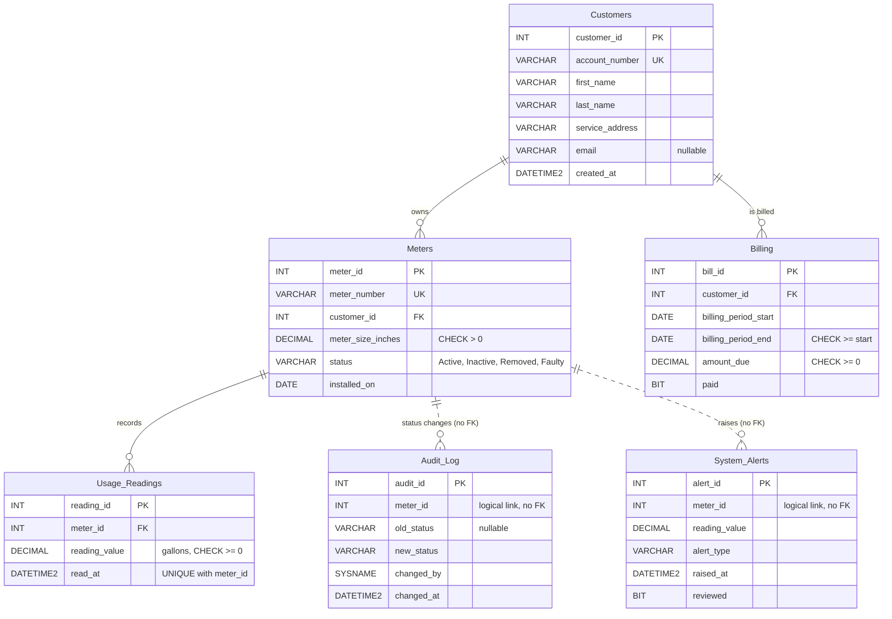

# Entity Relationship Diagram

SCV Water Operations Database (`SCV_Operations`, Microsoft SQL Server). Generated from `01_schema_setup.sql`. All data is synthetic.

Solid lines are enforced foreign keys. Dotted lines are logical links with no foreign key: `Audit_Log` and `System_Alerts` are written by triggers and deliberately avoid a foreign key so a log write is never blocked by a lock or delete on the source row.
